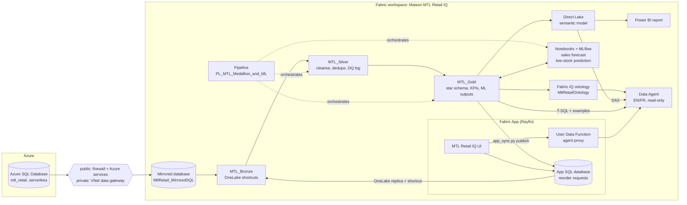

# Maison MTL Retail IQ: an end-to-end Microsoft Fabric demo

A redeployable, **synthetic** Microsoft Fabric demonstration for **Maison MTL**, a fictional Quebec fashion and
department store chain. In about an hour of mostly unattended deployment it builds the full analytics loop:

operational Azure SQL → zero-ETL **mirroring** → **medallion** lakehouses → **machine learning** forecasts and
stock-out predictions → a **Direct Lake** semantic model and a green-and-white **Power BI** report → a **Fabric IQ
ontology** → a bilingual (EN/FR) **Data Agent** → a protected **Fabric App** where store employees see sales and
inventory, ask the agent questions, and submit reorder requests that flow back into analytics.

> **Fictional company, synthetic data.** Maison MTL is invented for this demo and is not affiliated with any real
> retailer. Store locations use Quebec cities for realism only. Every store name, product, brand, supplier, price,
> quantity and KPI is generated deterministically by `mtl_data.py`.

## Why it matters (the value story)

| Without Fabric | With this demo on Fabric |
|---|---|
| Nightly ETL copies from the POS/inventory database | **Mirroring** replicates Azure SQL to OneLake in near real time, no pipelines to maintain |
| Data cleansing hidden in spreadsheets | **Silver** quarantines, deduplicates and standardizes, with a `dq_events` audit trail |
| Forecasts built offline by a few specialists | **LightGBM** models tracked in MLflow and registered next to the data |
| Import models and refresh windows | **Direct Lake** reads Gold Delta tables directly |
| Business terms differ between teams and tools | One **ontology** shared by people and AI, with EN/FR synonyms |
| Analysts field ad-hoc questions | A read-only **Data Agent** answers in English or French with governed numbers |
| Insights stop at the dashboard | A **Fabric App** turns a stock-out alert into a reorder request that lands back in Gold |

The storyline: an early **cold snap** hits Quebec in late October 2026. Parkas, winter boots, toques and mitts sell
out, supplier POs are late, and the distribution centre (DC-QC) runs low. The demo shows how a store employee spots
the risk, asks the agent, and requests a reorder, closing the loop for the buyers.

## Architecture



Details: [docs/ARCHITECTURE.md](docs/ARCHITECTURE.md).

## What's included

| Path | Purpose |
|---|---|
| `deploy.py` | Ordered, resumable deployment entrypoint (`check`, `all`, single steps, `loop`, `teardown`) |
| `config.example.json`, `settings.py` | Environment configuration template and loader; copy to `config.json` (git-ignored) |
| `mtl_reference.py`, `mtl_data.py` | Deterministic synthetic data: 10 stores + DC, 60 SKUs, 2 years of sales, inventory and orders, deliberate data-quality defects |
| `azure_sql.py`, `seed_loader.py`, `spn.py` | Azure SQL server/database, seed load (public or private path), mirroring service principal |
| `mirror.py` | Fabric connection, mirrored database, replication and row-count verification |
| `medallion.py`, `nb_*.py` | Bronze shortcuts, Silver/Gold/ML/reorder notebooks, orchestration pipeline |
| `model.py`, `report.py` | Direct Lake semantic model with governed measures; six-page PBIR report |
| `ontology.py`, `agent.py` | Fabric IQ ontology and graph refresh; Data Agent sources, instructions, few-shots, MCP evaluation |
| `app_sync.py`, `app/` | Rayfin Fabric App (React UI, entities, server-side agent proxy) and Gold ↔ app sync |
| `fabric.py` | Write-scoped Fabric REST operator: refuses writes outside the tracked workspace |
| `teardown.py` | Deletes only what the deployment created |
| `tests/` | Data, configuration, safety-guard and repository-hygiene tests |
| `docs/` | Architecture, deployment, data model, ML, agent, app, demo narrative and troubleshooting |

## Prerequisites

Summary below; full detail and the exact permissions are in [docs/DEPLOYMENT.md](docs/DEPLOYMENT.md#prerequisites).

- **Microsoft Fabric capacity**: a paid F-SKU (tested on F16; F8 or higher recommended for Spark, ML and the agent).
  The Data Agent does not run on trial capacities. You need Contributor (or Admin) rights on the capacity to assign
  the workspace.
- **Fabric tenant settings** (admin portal): users can create Fabric items; mirroring; Copilot and Azure OpenAI
  features (plus cross-geo processing if your capacity region requires it); Data Agent; Ontology and Graph (Fabric
  IQ, preview); Fabric Apps / User Data Functions (preview); semantic model *Execute Queries* REST API. In private
  mode, managed private endpoints must be allowed.
- **Azure**: a subscription where you can create a resource group and an Azure SQL server (Contributor), or an
  existing server where you are the Entra admin. Private mode also needs a VNet data gateway that can reach the
  server's private endpoint and rights to approve private endpoint connections on the server.
- **Microsoft Entra ID**: permission to create an app registration (default user setting or Application Developer).
  The app's service principal only signs in to Azure SQL; it does not need Fabric API access.
- **Tools**: Python 3.12+ (tested with 3.14), Azure CLI 2.60+ (tested with 2.92), Node.js 20+ and npm 10+ (tested
  with Node 26 / npm 12), ODBC Driver 18 for SQL Server, Git. The Rayfin CLI is installed from `app/package.json`.

## Quick start

```powershell
git clone https://github.com/mbenslimen_microsoft/maison-mtl-retail-iq.git
cd maison-mtl-retail-iq
python -m venv .venv; .\.venv\Scripts\Activate.ps1     # macOS/Linux: source .venv/bin/activate
pip install -r requirements.txt
copy config.example.json config.json                    # then edit config.json
az login --tenant <tenantId>
cd app; npm ci; npx rayfin login --tenant <tenantId>; cd ..
python deploy.py check                                  # read-only validation
python deploy.py all                                    # about 60-90 minutes, resumable
```

Then open the app URL printed at the end (also in `artifacts/app.json`), sign in with your Fabric account, submit a
reorder request from **Forecast & stock risk**, and close the loop:

```powershell
python deploy.py loop
```

`python deploy.py list` shows every step. Re-running `all` skips completed steps; `--from <step>` re-runs from a step.
Step-by-step instructions and expected outputs: [docs/DEPLOYMENT.md](docs/DEPLOYMENT.md).

### Choosing the network path

| `sql.network` | When to use | How data is loaded | How Fabric mirrors |
|---|---|---|---|
| `public` (default) | Your policy allows a public Azure SQL endpoint | Temporary firewall rule for the deployer's IP, Entra token auth; the rule is removed afterwards | Cloud connection; the server's *Allow Azure services* rule stays on |
| `private` | The server must stay private (for example Azure Policy forces public access off) | A throwaway Fabric workspace with a managed private endpoint runs a seed notebook, then the endpoint and workspace are deleted | Connection through your VNet data gateway |

The private path keeps the managed private endpoint out of the demo workspace on purpose: a workspace with a managed
VNet loses Spark starter pools for good, which would make notebooks and ML start slowly during live demos.

## Verification

Each step reads back what it created and fails loudly on a mismatch:

- the seed and mirrored row counts match the generator exactly (243,893 raw sales rows, 483,268 inventory rows, …);
- Silver and Gold notebooks assert the governed controls (for example net sales for the last 28 days 3,010,708 CAD,
  +21.3% vs last year; 19 positions out of stock);
- the semantic model is checked with DAX against the same controls, and the report's visual bindings are executed;
- the ontology graph refresh must complete, and the agent's published definition is read back;
- `python deploy.py evaluate` asks the Data Agent 20 questions (EN and FR, KPIs, filters, weekly windows, pending
  reorders and a guardrail) through its MCP endpoint and checks each answer against values computed from Gold;
- `app/scripts/verify-e2e.mjs` signs in headlessly and checks the deployed app end to end (see
  [docs/APP.md](docs/APP.md#end-to-end-verification)).

Run the local checks with:

```powershell
python -m unittest discover -s tests
cd app; npm ci; npm test; npm run lint; npm run build
cd rayfin/functions; npm ci; npm test
```

## Cost

- **Azure SQL Database** serverless General Purpose (Gen5, 0.5–1 vCore, 10 GB max, LRS backups): compute is billed
  only while active and auto-pauses after `sql.autoPauseDelayMinutes` (default 60). Storage is under 1 GB.
- **Fabric**: everything else runs on your capacity and consumes capacity units when used (mirroring, notebooks, the
  pipeline, Direct Lake queries, the agent, the app's SQL database and function). Mirroring compute and its OneLake
  storage are free up to the capacity's allowance. The pipeline has no schedule.
- The capacity itself is billed while it is running. Pause it when you are not demoing.

## Cleanup

```powershell
python deploy.py teardown          # dry run: lists what would be deleted
python deploy.py teardown --yes    # deletes it (add --keep-sql to keep the database)
```

Teardown deletes only resources the deployment created and tracked: the loader workspace (if still present), the
demo workspace and every item in it including the Fabric App, the Fabric connection, the mirroring app registration,
and the database (or the whole server and an empty resource group when the deployment created them). Local state is
archived to `artifacts-teardown-<timestamp>/`.

## Documentation

- [Architecture](docs/ARCHITECTURE.md)
- [Deployment](docs/DEPLOYMENT.md): configuration, prerequisites, step-by-step with expected outputs
- [Data model](docs/DATA_MODEL.md): Bronze/Silver/Gold, data-quality rules, KPI controls, semantic model, ontology
- [Machine learning](docs/ML.md)
- [Data Agent](docs/AGENT.md): sources, routing, instructions, evaluation and lessons learned
- [Fabric App](docs/APP.md): Rayfin, authentication, reorder write-back loop
- [Demo narrative](docs/DEMO_NARRATIVE.md): presenter walkthrough
- [Troubleshooting](docs/TROUBLESHOOTING.md)

## Security notes

- No secrets are stored in the repository or on disk. The mirroring service principal's secret is minted in memory
  and sent only to the Fabric connection API.
- All Fabric writes go through `fabric.py`, which refuses anything outside the tracked workspace and only deletes the
  workspace or connection during an explicit teardown.
- The Azure SQL server uses Entra-only authentication. The app's browser never receives a Fabric token: the agent is
  called server-side by a User Data Function with the signed-in user's identity.
- The agent is read-only and refuses to place, approve or change orders.

## License and disclaimer

Provided as a sample for demonstration purposes, without warranty. Maison MTL is fictional; any resemblance to a real
company is coincidental. Preview features (Fabric IQ ontology, Data Agent MCP endpoint, Fabric Apps) may change.
